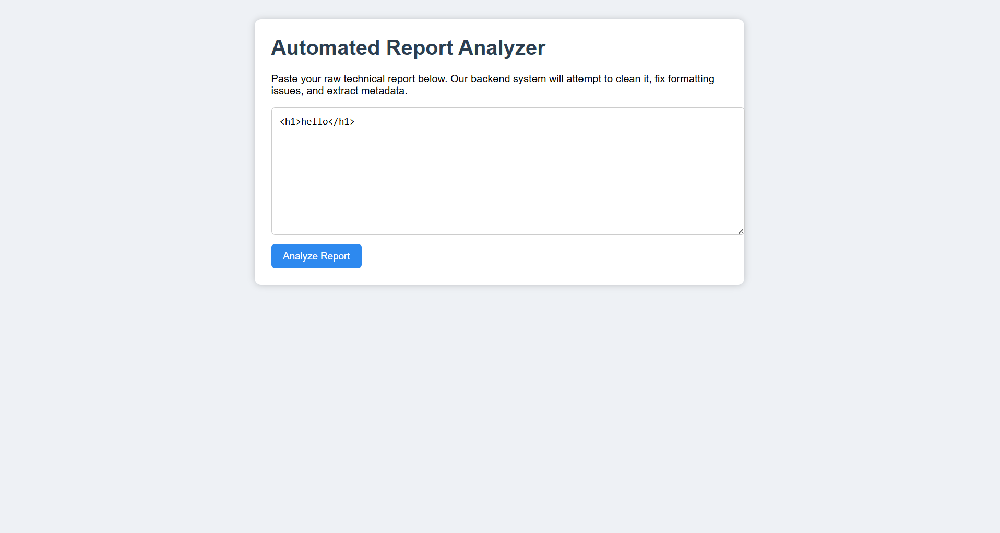
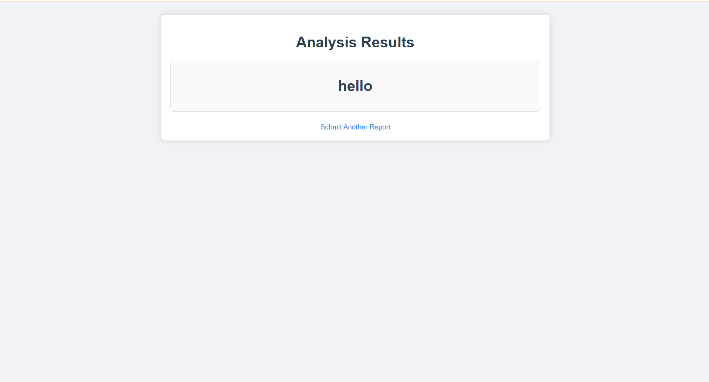
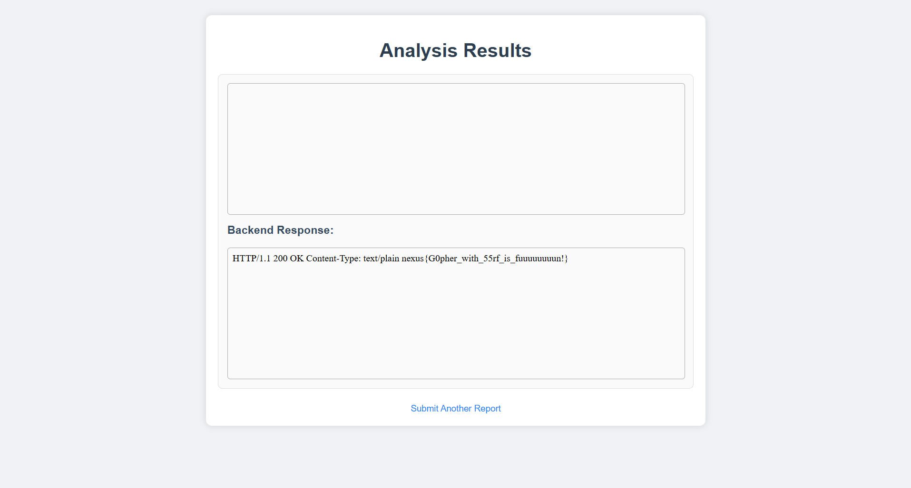

#  Challenge Write-Up: gofrita

**Author** : 0xsila 

##  Challenge Name
**gofrita**

## Challenge Description :
When script kiddies report anything they find, architects try to escalate it to maximize the impact.
Which one are you?

a lot of bugbounty hunters or hackers hhhh report any bug they found (open redirect , html injection , user enumeration ....) , but the real architecturs try to maximize the impact ( open redirct => xss or oauth bug , html injection => xss or ssrf )
## Vulnerability Chain

**Iframe Injection → SSRF → Gopher Protocol → Header Bypass (`X-Original-URL`)**

---

## Challenge Overview
The goal of **gofrita** is to exploit a chained vulnerability that starts from a **client-side iframe injection** and ends with a **Server-Side Request Forgery (SSRF)** using the **Gopher protocol**, while bypassing internal access restrictions via the **`X-Original-URL`** header.

---

## Steps :
The application allows user-controlled input to reflected in the UI without proper sanitization , the player start inject and try all what he know .
finnaly he got : **html injection** , and a **self xss** that he can not escalte to nothing ( in real world , try to chaine it with csrf or web cache poisining )

so the player continue with the **html injection** , the max impact now will be **iframe injection** ( in bugbounty , it will be considred as medium or even high if u got full screen and made a **DoS** )

thinking again as a ctf player , we still have to get the flag , and we had the **iframe injection** , start thinking for **ssrf** ( that what i hope u think about )

start using hacktricks tips , inject some ssrf paylods from payload all the things , but nothing work , keep seeing errors that told u go to study for exams .

trying to get some hints from the author ( it was me ) , and he still saying : **try harder**

btw the ctf idea was about gopher , so after the try harder from the player , it suppose that he try the gopher protocol , and start getting some custom errors , now he start being close .

**Why Gopher is powerful:**  
Gopher enables sending **raw TCP payloads**, which means we can:
- Fully control the request structure
- Inject custom HTTP headers
- Interact with internal services directly

the player suppose to undertand each error is for what , and start customize his paylod .

after a lot of trying harder : the player arrive to this point of paylod :

**`<iframe src="gopher://127.0.0.1:3333/_GET%20/flag.txt%20HTTP/1.1%0d%0aHost:%20127.0.0.1%0d%0a%0d%0a%0d%0a">`**

here a lot of players stop playing and start complain about the challenge , and saying : it is guessy

but the real winners continue and go deeper , thinkig what will the author block ?

when the player start thinking that i blocked him to access directly to the flag , this is the last step between him and the flag

searching about some bypass of urls blcking , and they will find : `X-Original-URL`

a lot of proxy servers trust this header , which allow us to do a lot of things with that header .

extra idea : chaine it with web cache poisining is great idea .

the final paylod: 

<iframe src="gopher://127.0.0.1:3333/_GET%20/blablabla%20HTTP/1.1%0d%0aHost:%20127.0.0.1%0d%0aX-Original-URL:%20/flag.txt%0d%0a%0d%0a"></iframe>

and get the flag : 

